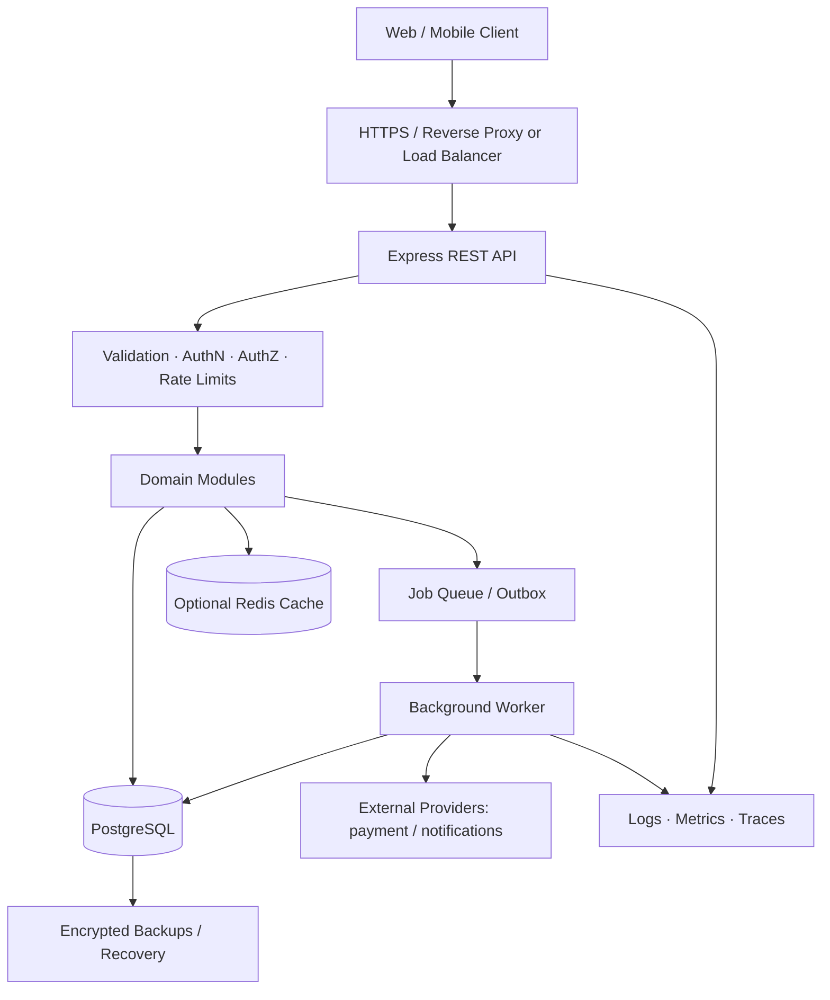
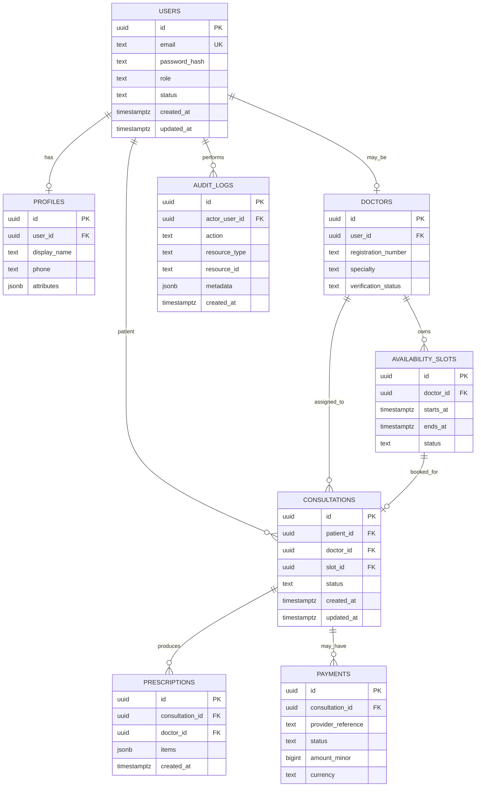
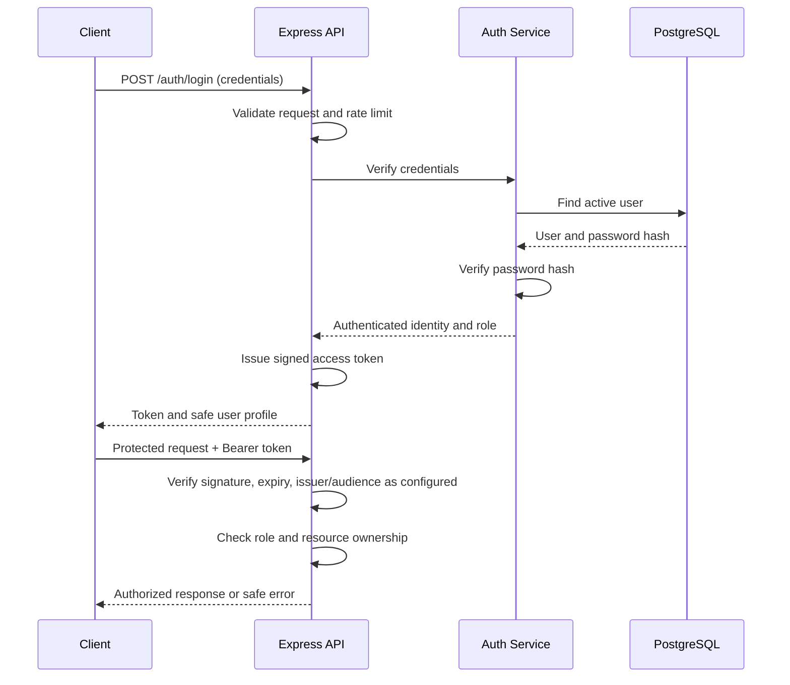
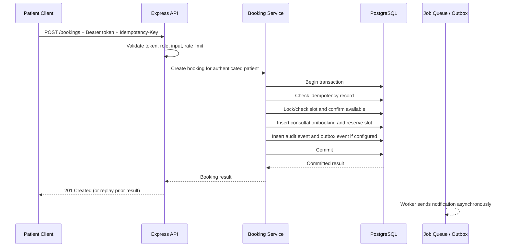

# Amrutam Telemedicine Backend — System Architecture

**Document type:** Main architecture reference  
**Status:** Target architecture / implementation guide  
**Stack:** Node.js, Express, PostgreSQL, REST API  
**Current implementation status:** Phase 1 foundation, Phase 2 core identity, and Phase 3 doctor discovery, profiles, and availability slots are implemented and verified (63 automated tests passing). Remaining domain modules in this document remain planned and must not be treated as implemented until code and tests confirm them.

## 1. Purpose and source requirements

This document translates the Amrutam backend assignment and project planning into one architecture reference. It covers the required telemedicine workflows, security, data model, API boundaries, concurrency, observability, scalability, deployment, and recovery.

The assignment requires:
- User lifecycle, authentication, and roles.
- Doctor availability and appointment booking.
- Consultation lifecycle and prescriptions.
- Search and filtering.
- Compliance and audit trails.
- Admin analytics.
- PostgreSQL; REST or GraphQL; modular services with dependency injection.
- Idempotent writes, asynchronous jobs for heavy tasks, rate limiting, validation, and secrets in environment variables.
- Architecture/data-flow, booking sequence, ER diagram, API schema, retries/backoff, partitioning, caching/concurrency, transaction/saga decisions, and backup/disaster recovery.
- Security measures including OWASP mitigation, attack-surface analysis, data classification, encryption, key rotation, audit logs, and dependency scanning.

## 2. Architecture principles

1. **Start with a modular monolith.** Keep one deployable Node.js/Express application, with clear domain modules and dependency boundaries. This is simpler to deliver and test within the assignment timeline than prematurely operating multiple microservices.
2. **Separate transport, business logic, and persistence.** Routes/controllers handle HTTP; services enforce business rules; repositories/data-access modules handle SQL; middleware handles cross-cutting concerns.
3. **PostgreSQL is the source of truth.** Use database constraints and transactions for booking correctness. Redis is optional and must not become the source of truth for appointment ownership.
4. **Secure by default.** Validate every request, use least-privilege role and resource checks, keep secrets outside source control, and avoid exposing sensitive health or error details.
5. **Make writes safe to retry.** Use idempotency keys for critical create/write operations and unique constraints where appropriate.
6. **Measure before claiming performance.** The assignment targets are goals, not proven results until load and reliability tests are run.
7. **Document actual status honestly.** This is a target design. Mark features as implemented only after code and tests verify them.

## 3. High-level architecture



### Component responsibilities

| Component | Responsibility |
|---|---|
| Client | Sends HTTPS requests; stores tokens safely according to client platform. Never decides authorization on its own. |
| HTTPS edge / load balancer | TLS termination, request routing, connection limits, and optional edge-level protections. |
| Express API | REST endpoints, request parsing, validation, authentication and authorization middleware, response formatting. |
| Domain services | Enforce business rules for users, doctors, availability, bookings, consultations, prescriptions, payments, audit, and analytics. |
| Repositories / data access | Parameterized SQL and transaction boundaries; no business decisions hidden in raw route handlers. |
| PostgreSQL | Durable transactional source of truth, constraints, relationships, audit records, and operational data. |
| Optional Redis | Cache appropriate read-heavy, non-authoritative data and/or coordinate rate limits if configured. Booking correctness remains enforced by PostgreSQL. |
| Background worker | Runs slow or retryable work such as notifications, analytics aggregation, and provider callbacks; uses bounded retries and idempotent handlers. |
| External providers | Payment gateway and notification services behind adapters; credentials kept in environment/secrets management. No real provider is assumed until selected/configured. |
| Observability | Structured logs, metrics, distributed traces, health/readiness checks, and alerts. |
| Backup/recovery | Encrypted, access-controlled backups and documented restore drills. |

### Why a modular monolith first?

It provides clear boundaries without the deployment and distributed-transaction cost of microservices. If load, team ownership, or operational evidence later justifies it, modules such as notifications or analytics can be extracted behind stable interfaces. Do not split services solely to make the architecture diagram look more complex.

## 4. Suggested code organization

Adapt this structure to the existing repository; inspect current files before creating duplicates.

```text
src/
  app.js                    # Express app and middleware wiring
  server.js                 # Server startup and graceful shutdown
  config/                   # Environment validation and configuration
  db/
    pool.js                 # PostgreSQL pool
    migrations/             # Versioned SQL migrations
    transaction.js          # Shared transaction helper, if useful
  middleware/
    authenticate.js         # Verify access token
    authorize.js            # Role/resource authorization helpers
    validate.js             # Request validation
    rateLimit.js            # Rate-limit configuration
    errorHandler.js         # Consistent safe error responses
  modules/
    auth/
      auth.routes.js
      auth.controller.js
      auth.service.js
      auth.repository.js
      auth.schemas.js
    users/
    doctors/
    availability/
    bookings/
    consultations/
    prescriptions/
    payments/
    audit/
    admin/
  jobs/                     # Worker handlers and retry policy
  observability/            # Logger, metrics, tracing setup
tests/
  unit/
  integration/
docs/
  # Optional additional diagrams and design notes
```

Each module should expose a small interface and receive dependencies through explicit imports or constructor/function injection. Avoid circular dependencies and direct database access from controllers.

## 5. Domain modules and ownership

| Module | Main responsibilities | Key access rule |
|---|---|---|
| Auth / Users | Registration, login, password hashing, token lifecycle, account status, roles | Public registration cannot create an admin account. |
| Doctor profiles | Doctor professional profile and searchable attributes | Only the doctor or authorized admin can modify the profile. Verification fields should be admin-controlled if included. |
| Availability | Doctor slots and availability changes | Only the owning doctor or authorized admin can manage slots. |
| Bookings | Book, cancel, and retrieve appointments | Patient identity comes from the verified token, not a client-supplied patient ID. |
| Consultations | Consultation status and lifecycle | Patient and assigned doctor may access only their permitted consultation; admins have explicitly scoped privileges. |
| Prescriptions | Create and read prescription records | Only an authorized clinician may create/update a prescription; patient access is limited to their own records. |
| Payments | Payment intent/status and provider references | Treat provider callbacks as untrusted until signature/authorization verification; never store raw card data. |
| Audit | Append-only records of sensitive actions | Restrict access; do not log passwords, access tokens, or unnecessary medical details. |
| Admin analytics | Aggregated operational metrics and summaries | Admin-only; prefer aggregates and minimize identifiable health data. |
| Jobs | Notifications, reconciliation, aggregation, provider callbacks | Handlers must be idempotent and retry-safe. |

## 6. Data model and relationships

The assignment explicitly names these core tables: `users`, `profiles`, `doctors`, `availability_slots`, `consultations`, `prescriptions`, `payments`, and `audit_logs`. The booking workflow also needs a durable booking record. The proposed design uses `consultations` as the appointment/consultation lifecycle record unless the implementation reveals a clear reason to separate `appointments` and `consultations`. Avoid duplicating the same lifecycle across two tables without a documented need.

### ER diagram (logical target)



**Schema notes and verified physical implementation:**
- **Reconciliation with logical target:** In the physical schema established in `001_initial_schema.sql` and additive migrations, `doctor_profiles` functions as the doctor entity, with `user_id UUID PRIMARY KEY REFERENCES users(id) ON DELETE CASCADE` anchoring doctor identity directly to the verified `users` account.
- **Doctor Profiles (`doctor_profiles`):** Columns: `user_id` (PK, FK), `full_name` (text, not null), `specialization` (text, not null), `bio` (text, nullable), `created_at` (timestamptz), plus Migration 003 columns: `verification_status` (text not null default `'pending'`, check: `'pending', 'approved', 'rejected'`), and `updated_at` (timestamptz default `now()`).
- **Doctor Discoverability Index:** Migration 003 added `idx_doctor_profiles_discoverable` on `(verification_status, specialization)` to optimize public doctor search queries filtered by status and specialty.
- **Availability Slots (`availability_slots`):** Columns: `id` (UUID PK), `doctor_id` (UUID FK to `doctor_profiles.user_id`), `starts_at` (timestamptz), `ends_at` (timestamptz), `status` (text check `'available', 'booked', 'unavailable'`), `created_at` (timestamptz), and Migration 003 `updated_at` (timestamptz). Constraints: `ends_at > starts_at`, unique `(doctor_id, starts_at)`.
- **Slot Query & Concurrency Indexes:** Existing index `idx_slots_doctor_start` plus Migration 003 index `idx_slots_doctor_status_start` on `(doctor_id, status, starts_at)`. Application concurrency control acquires row-level locks on the doctor profile (`SELECT user_id FROM doctor_profiles WHERE user_id = $1 FOR UPDATE`) within transactions to serialize concurrent slot creations and prevent interval overlap races.
- **Normalized Email Index:** Migration 002 added unique index `users_email_normalized_uidx` on `lower(btrim(email))`.
- **Audit Logs & Consultations:** Retained from `001_initial_schema.sql` for Phase 4 booking and Phase 6 consultations. Slot deletion safeguards strictly verify that slots referenced in `consultations` or marked `'booked'` cannot be deleted.

## 7. API design and contract conventions

Base path: `/api/v1`. Use REST and JSON. The authoritative endpoint list and exact schemas belong in `API_CONTRACT.md` and OpenAPI; keep that contract aligned with actual implementation.

### Planned endpoint groups

| Area | Example endpoint | Purpose |
|---|---|---|
| Auth | `POST /auth/register` | Register a patient or doctor using an allowed role. |
| Auth | `POST /auth/login` | Verify credentials and issue a token. |
| Auth | `GET /auth/me` | Return the authenticated user's safe profile. |
| Doctors | `GET /doctors` | Search/filter doctors. |
| Doctors | `GET /doctors/:doctorId` | Read a public/approved doctor profile. |
| Availability | `GET /doctors/:doctorId/slots` | Search available slots. |
| Availability | `POST /doctors/me/slots` | Doctor creates slots. |
| Bookings | `POST /bookings` | Create a booking with idempotency protection. |
| Bookings | `GET /bookings/me` | List the authenticated patient's bookings. |
| Bookings | `POST /bookings/:bookingId/cancel` | Cancel if allowed by lifecycle rules. |
| Consultations | `GET /consultations/:id` | Read a consultation after resource authorization. |
| Consultations | `PATCH /consultations/:id/status` | Transition status after role and state validation. |
| Prescriptions | `POST /consultations/:id/prescriptions` | Create a prescription as an authorized doctor. |
| Prescriptions | `GET /consultations/:id/prescriptions` | Read prescriptions with resource-level authorization. |
| Payments | `POST /consultations/:id/payments` | Start payment flow if payment integration is in scope. |
| Admin | `GET /admin/analytics` | Read admin-only aggregate analytics. |
| Audit | Internal service operation | Record sensitive actions; direct public audit mutation should not be exposed. |

These are proposed paths to guide the contract, not confirmed existing routes. Define exact schemas, status codes, authentication rules, pagination, and error formats in `API_CONTRACT.md`.

### API conventions

- Validate path parameters, query parameters, headers, and JSON bodies.
- Use a consistent success response shape and a consistent error shape.
- Use appropriate status codes: `201` for created resources, `400` for invalid input, `401` for unauthenticated requests, `403` for forbidden actions, `404` for missing/inaccessible resources where appropriate, `409` for conflicts, and `429` for rate limits.
- Do not return stack traces, SQL errors, password hashes, secrets, or unnecessary medical information.
- Paginate list/search endpoints; set sensible maximum page sizes.
- Use an `Idempotency-Key` on critical write endpoints such as booking/payment initiation; define key scope, request hash, retention, and replay behavior in the API contract.
- Document endpoints using OpenAPI and add contract tests where practical.

## 8. Authentication and authorization

### Authentication flow



### Required controls

- Hash passwords with a modern password-hashing algorithm and suitable parameters; never encrypt or store them as plaintext.
- JWT signing secret/key must be strong, environment-provided, and never committed. Define expiration and token invalidation/account-disable behavior.
- Reject expired, malformed, or incorrectly signed tokens.
- Never allow public registration to assign the `admin` role. Provision administrators through a controlled process.
- Role checks alone are not enough: enforce resource ownership and assignment checks (for example, a patient can read only their own consultations).
- Add MFA in the later security-hardening phase, as required by the assignment. Do not imply it exists before implementation and testing.
- Apply login rate limits, input validation, generic credential errors, and safe logging.
- Define token storage/refresh/revocation choices explicitly before adding refresh tokens. Avoid adding refresh-token complexity without a clear requirement.

### Authorization model

| Role | Typical allowed actions |
|---|---|
| Patient | Manage permitted own profile; browse doctors/slots; book/cancel own eligible appointments; read own consultations and prescriptions. |
| Doctor | Manage own permitted profile and slots; view assigned consultations; update allowed consultation states; create prescriptions for assigned consultations. |
| Admin | Manage approved administrative workflows and view aggregate analytics; privileged actions must be logged. |
| Unauthenticated | Access only intentionally public routes such as login, registration, health, and public doctor search. |

The exact permission matrix must be enforced in code and tests, not only documented here.

### Phase 2 implementation status

Patient and doctor accounts are created in `users`; passwords are bcryptjs hashes, and public registration cannot assign `admin`. `POST /auth/login` issues HS256 JWT access tokens with a 15-minute default expiry (`JWT_EXPIRES_IN`, maximum 24 hours). Authentication middleware checks the signature, expiry, account-active flag, and current database role. `GET /auth/me` returns only the safe identity fields. The reusable role middleware is tested directly; no business route is yet restricted by role. MFA, refresh/revocation tokens, dedicated login throttling, and account recovery remain out of scope.

## 9. Booking flow, transactions, and concurrency

### Sequence diagram



### Correctness rules

1. Derive `patient_id` from the authenticated identity, never from a trusted-looking client body field.
2. Use a PostgreSQL transaction for the booking's related state changes.
3. Protect the slot with a row lock or equivalent atomic conditional update and enforce a unique/exclusion constraint appropriate to the schema.
4. Two concurrent requests for the same slot must not both succeed.
5. Store and check idempotency keys for critical writes. A repeated key with the same request should replay the original result; reuse with a different request should return a conflict.
6. Commit booking and associated audit/outbox records atomically when they must not diverge.
7. Send notifications only after commit; do not hold a database transaction open while calling external services.
8. Use explicit consultation/booking state transitions and reject invalid transitions.
9. Avoid retrying non-idempotent operations blindly.

### Transaction versus saga

- **Use a local PostgreSQL transaction** for booking, slot reservation, and related local records.
- **Use an outbox/worker or saga-style orchestration** when a workflow crosses external systems, such as payment and notifications. External calls cannot be made atomic with a PostgreSQL transaction.
- Define compensation/reconciliation behavior for payment failures or delayed provider callbacks. A saga is not needed for every CRUD operation.

## 10. Search, caching, and scaling

### Search and read performance
- Add indexes based on actual query patterns, such as normalized email uniqueness, doctor specialty/verification filters, slot doctor/time/status, consultation patient/doctor/status/date, and payment provider reference.
- Use `EXPLAIN ANALYZE` on representative queries before adding complex optimizations.
- Paginate doctor search and admin analytics; avoid unbounded result sets.
- Cache only data with a clear invalidation strategy, such as public doctor profile/search results. Invalidate or expire cache on relevant writes.
- Do not rely on cache for slot exclusivity, payment state, or access-control decisions.

### Scale target and deployment path
The assignment cites 100,000 daily consultations, p95 reads under 200 ms, p95 writes under 500 ms, and 99.95% availability. These are target requirements; they must be validated under a documented workload before being claimed.

A practical scale path:
1. Measure query and API performance.
2. Tune PostgreSQL indexes, pool sizing, pagination, and expensive queries.
3. Use stateless API instances behind a load balancer.
4. Move slow work to a worker/queue.
5. Add Redis only for measured cache/rate-limit needs.
6. Add read replicas or partition large tables when measurements justify them and consistency needs are understood.
7. Consider partitioning high-volume time-series tables (for example, audit records) by time after measuring table growth and query patterns.

Do not introduce Redis, replicas, or partitioning merely for appearance; document whether each is implemented, simulated, or a future design.

## 11. Async jobs, retries, and external integrations

Good candidates for background processing:
- Appointment notifications.
- Payment reconciliation and provider callbacks.
- Analytics aggregation and report generation.
- Other work that is slow or not required to complete the immediate HTTP response.

Retry policy:
- Retry only transient errors (timeouts, selected network errors, temporary provider/server errors).
- Use exponential backoff with jitter and a maximum attempt count.
- Apply timeouts and concurrency limits.
- Ensure each job is idempotent; use a dead-letter/manual-recovery path after exhausted retries.
- Do not retry validation, authorization, or other permanent errors.
- Use an outbox pattern where a committed database change must reliably trigger asynchronous work.

## 12. Security, privacy, and compliance

### Data classification

| Data class | Examples | Handling |
|---|---|---|
| Credentials/secrets | Password hashes, JWT signing keys, provider credentials | Strong hashing for passwords; secrets manager/environment configuration; strict access; rotation procedure. |
| Sensitive health data | Consultations, prescriptions, relevant patient details | Least-privilege access, TLS in transit, encrypted storage/backups, access audit, minimal exposure in logs. |
| Personal data | Name, email, phone | Access control, validation, minimize collection and retention. |
| Operational data | Health status, metrics, aggregate analytics | Avoid sensitive payloads and identifiers where not needed; restrict admin views. |
| Audit records | Actor, action, resource, timestamp | Restricted write/read access, append-oriented design, integrity and retention policy. |

### Threats and mitigations

| Threat | Primary mitigations |
|---|---|
| Broken authentication / credential stuffing | Strong password hashing, rate limits, generic errors, MFA in security phase, secret rotation. |
| Broken access control / IDOR | Server-side role and resource ownership checks on every sensitive endpoint; negative authorization tests. |
| SQL injection | Parameterized SQL, input validation, least-privilege database role. |
| Booking race / duplicate writes | Transactions, locks/atomic updates, database constraints, idempotency keys. |
| Sensitive data leakage | TLS, encrypted backups/storage where supported, redacted logs, safe errors, minimum response fields. |
| Abuse / denial of service | Rate limiting, request-size limits, timeouts, pagination, connection-pool limits, edge controls. |
| Forged payment callback | Verify provider signature, amount/currency/reference, and idempotently reconcile state. |
| Supply-chain vulnerability | Lockfile, dependency scanning, review updates, CI audit policy, timely remediation. |
| Secret exposure | `.env` in `.gitignore`, secret scanning, restricted deployment secrets, key rotation plan. |
| Audit tampering or overexposure | Narrow DB permissions, append-oriented records, restricted audit access, integrity/retention controls. |

Follow relevant OWASP guidance for API and web risks. Legal/compliance obligations depend on deployment jurisdiction and business context; do not claim a specific certification or legal compliance without evidence.

## 13. Observability and reliability

- **Logs:** Structured logs with request/correlation IDs, route, status, latency, and safe error metadata. Redact tokens, credentials, and sensitive health data.
- **Metrics:** Request count, latency percentiles, error rates, database pool utilization, query latency, job backlog/failures, booking conflicts, and provider failures.
- **Traces:** Trace requests across API, database calls, and workers where instrumentation is configured.
- **Health:** Liveness confirms the process can run; readiness confirms required dependencies, especially PostgreSQL, are available.
- **Alerts:** Define thresholds for error rate, latency, database saturation, job failures, and availability.
- **SLO validation:** Report p95 read/write latency and availability only from reproducible measurements and a stated test window.

## 14. Deployment, CI/CD, and configuration

Target deployment:
- Containerize the API and worker.
- Keep configuration and secrets outside the image.
- Use a non-root runtime user where practical.
- Run migrations as a controlled deployment step; do not have every application replica race to apply migrations at startup.
- CI should install from the lockfile, run tests, lint/type checks if configured, scan dependencies, and build the container.
- Deploy with health/readiness checks and a rollback plan.
- Apply least-privilege DB credentials and network access.
- Use environment-specific settings; never commit production secrets.

## 15. Backup and disaster recovery

- Define recovery point objective (RPO) and recovery time objective (RTO) appropriate to the system; do not invent achieved values.
- Take automated, encrypted, access-controlled backups and use PostgreSQL point-in-time recovery if supported by the chosen hosting setup.
- Store backups separately from the primary database failure domain.
- Test restore procedures periodically and document the last successful restore test.
- Document migration rollback/forward-fix strategy, incident ownership, and recovery verification.
- Treat backup existence as insufficient; recovery is proven by a successful restore test.

## 16. Testing strategy

- **Unit tests:** service business rules, validators, authorization helpers, state transitions, retry/idempotency logic.
- **Integration tests:** PostgreSQL repositories, migrations, registration/login, access control, booking transactions, audit records.
- **Concurrency tests:** multiple requests trying to reserve the same slot; verify only one succeeds.
- **Security tests:** missing/invalid/expired token, role escalation attempts, cross-user record access, injection-shaped input, rate limiting.
- **Contract tests:** endpoint schemas, status codes, error formats, OpenAPI consistency.
- **Performance tests:** representative read/write workloads; record p95 and error rates. Do not claim targets without results.
- **Recovery tests:** restore a backup and verify critical records.
- Run tests in CI and keep the test database isolated from development/production data.

## 17. Mapping to implementation phases

| Roadmap phase | Architecture areas |
|---|---|
| 1. Foundation and database | Express app, environment configuration, PostgreSQL pool, migrations, health/readiness, error handling. |
| 2. Authentication Part 1 — Core identity | Users/auth module, password hashing, login, JWT middleware, basic RBAC, validation and tests. |
| 3. Doctor profiles, availability, search | Doctor and availability modules, search indexes, role/ownership rules. |
| 4. Booking | Transactional booking service, database constraints, idempotency, concurrency tests. |
| 5. Authentication Part 2 — Security hardening | MFA, stronger sensitive-resource authorization, security review and threat model. |
| 6. Consultations and prescriptions | Consultation lifecycle, prescription module, audit events and access checks. |
| 7. Payments and admin | Payment adapter/state reconciliation, admin analytics, audit access. |
| 8. API documentation and quality | OpenAPI, contract tests, CI quality gates. |
| 9. Observability and resilience | Logs, metrics, traces, retries, workers, cache decisions, operational alerts. |
| 10. Deployment and submission | Containers, IaC, CI/CD, architecture/ER/sequence docs, security checklist, backup/DR plan, README and demo. |

## 18. Current state versus target state

**Verified current state**
- Node.js/Express starter runs.
- PostgreSQL 16 database `amrutam` exists.
- Initial migration has been executed.
- Health endpoint responds.
- Readiness endpoint confirms database connectivity.
- Baseline test suite passes 2 tests.

**Not yet verified as implemented**
- Registration/login, JWT, and RBAC.
- Doctor profiles and availability APIs.
- Booking, idempotency, and concurrency controls.
- Consultations, prescriptions, payments, admin analytics, and audit coverage.
- MFA.
- OpenAPI, CI/CD, containers/IaC, production observability, load testing, and backup/restore validation.

This document is the main design reference, not proof of implementation. Update it when architecture decisions change and record the reason in `Amrutam_Backend_Development_Change_Log.md`. Keep `API_CONTRACT.md` synchronized with the actual API and OpenAPI specification.
