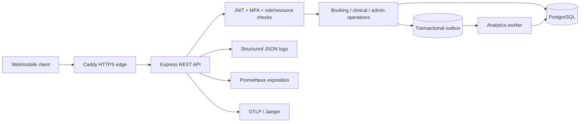
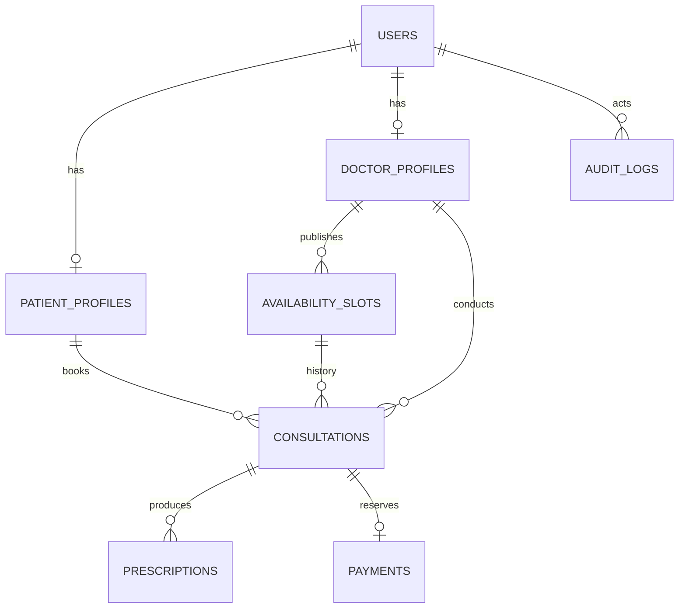

# Amrutam — Submission Architecture

This concise architecture is intended to accompany the detailed `ARCHITECTURE.md`, the OpenAPI schema, and the evidence in `SUBMISSION.md`. The implementation is a single Express application and PostgreSQL database, with a separately runnable analytics worker.

## 1. Components and data flow



PostgreSQL is authoritative for identity, availability, bookings, prescriptions, audit events, and idempotency. Redis is optional and is not used. A modular monolith avoids distributed transactions during initial delivery. Clinical services accept an injected pool; transaction, validation, MFA, and audit utilities are separate modules. Older authentication/doctor/booking handlers still contain SQL; that separation is incomplete and is a documented maintainability follow-up.

The public API uses `/api/v1`; OpenAPI is served at `/api/v1/openapi.json`. JWTs contain identity, role, session version, MFA state, issuance and expiry. Authentication verifies signature/expiry, rechecks the active database user and role, rejects revoked session versions, and requires an MFA claim for enrolled accounts. Doctor/admin access to clinical records and admin operations requires MFA. Patients can access only their own clinical records.

## 2. Data model and booking correctness



The assignment's logical `profiles` and `doctors` entities are represented by `patient_profiles` and `doctor_profiles`, keyed to `users`. `consultations` also stores the booking lifecycle, avoiding duplicate appointment entities. Cancelled history remains intact; a partial unique index permits at most one non-cancelled consultation per slot. Prescriptions are immutable inserts with doctor-scoped idempotency keys. Payment storage exists; real gateway/refund/webhook integration is explicitly outside the delivered integration boundary.

```mermaid
sequenceDiagram
  Patient->>API: POST /bookings + Bearer + Idempotency-Key
  API->>DB: BEGIN; lock patient/key (advisory)
  API->>DB: Check existing request; lock slot FOR UPDATE
  API->>DB: Validate availability and approved doctor
  API->>DB: Reserve slot; insert consultation and audit
  API->>DB: COMMIT
  API-->>Patient: 201 creation or stable replay
```

Concurrent identical requests serialize even when no idempotency row exists yet. Same key with different payload returns 409. Unique violations require rollback before recovery reads. Creation replay stays stable after cancellation; detail reads return current state. Availability create/update share a doctor lock, and historical slot times cannot be edited. Cancellation changes consultation and slot state with an audit entry in one transaction. Consultation transitions are `scheduled → in_progress → completed`; repetition of current state is idempotent. Cancelled/completed records cannot be restarted.

## 3. Security, observability and resilience

Passwords use bcrypt cost 12; public admin registration is impossible. MFA uses OTPAuth TOTP, AES-256-GCM encrypted seeds bound to account IDs, ten-minute enrollment, replay-step checks, and hashed single-use recovery codes. MFA confirmation and logout-all revoke prior tokens by incrementing session version. Clinical reads/writes and administrative actions are audited. Parameterized SQL, strict validation, bounded lists, Helmet, configured CORS, request-size limits, and dedicated authentication throttling reduce API attack surface. Secret values and clinical payloads are omitted from application logs.

JSON request logs include correlation ID, route template, status, latency, and trace ID when tracing is enabled. Protected Prometheus exposition includes request counts/latency and process metrics. OpenTelemetry is preloaded before Express/pg and sends traces to an optional OTLP collector. Liveness and database readiness are separate. Deployment infrastructure is defined with Docker Compose; a production overlay adds Caddy TLS. PostgreSQL TLS verification is enabled by default in production; local Compose explicitly disables it on its private network.

Clinical state/prescription transactions enqueue aggregate-refresh jobs. A worker claims jobs with `FOR UPDATE SKIP LOCKED`, overwrites a snapshot idempotently, and marks completion transactionally. Transient errors use bounded exponential backoff plus jitter, maximum five attempts; permanent/exhausted jobs remain failed for operator review. Heavy external notifications/payment calls are not performed inside database transactions. Future provider integrations should use signed callbacks, outbox delivery, reconciliation and explicit compensation, rather than pretending a local transaction covers the provider.

## 4. Scaling, recovery and evidence

100k consultations/day averages roughly 1.16 consultations/second; peak ratios and per-consultation API calls must be measured. The 200ms read/500ms write p95 and 99.95% availability figures are requirements, not demonstrated guarantees. Indexes support slot discovery, consultation ownership/status/date queries, and prescription history. Connection pooling and bounded queries are implemented. Start with measured query tuning and stateless API replicas; introduce distributed rate limiting before multi-replica deployment. Cache only public doctor metadata with bounded TTL/invalidation; never use cache as booking or authorization authority.

Partition audit history by time only after measuring growth and retention needs; migrate indexes and query plans before enabling partitions. Read replicas are suitable for tolerant aggregates, not slot ownership decisions. No replicas, Redis cache, partitions, or load benchmark are claimed as deployed.

Use encrypted off-host backups and PostgreSQL WAL/PITR with managed storage where available. Define business-approved RPO/RTO; suggested planning targets are RPO 15 minutes and RTO 1 hour, both unverified. Restore into an isolated database, validate constraints and counts, run smoke workflows, and record recovery duration. Versioned migrations use forward fixes; never rewrite applied migrations. Operational instructions and gaps appear in `OPERATIONS.md` and `SECURITY.md`.

Verification includes mocked HTTP regressions, MFA crypto tests, and disposable PostgreSQL tests for locking, retries, authorization, audit rollback, migration behavior, clinical lifecycle and jobs. CI runs installation, tests, OpenAPI validation, dependency auditing and a container build. The manual publication workflow publishes an immutable commit-tagged image when a maintainer dispatches it. Cloud deployment, actual uptime, restore drills, and the user's five-minute recording remain external verification/delivery steps.
